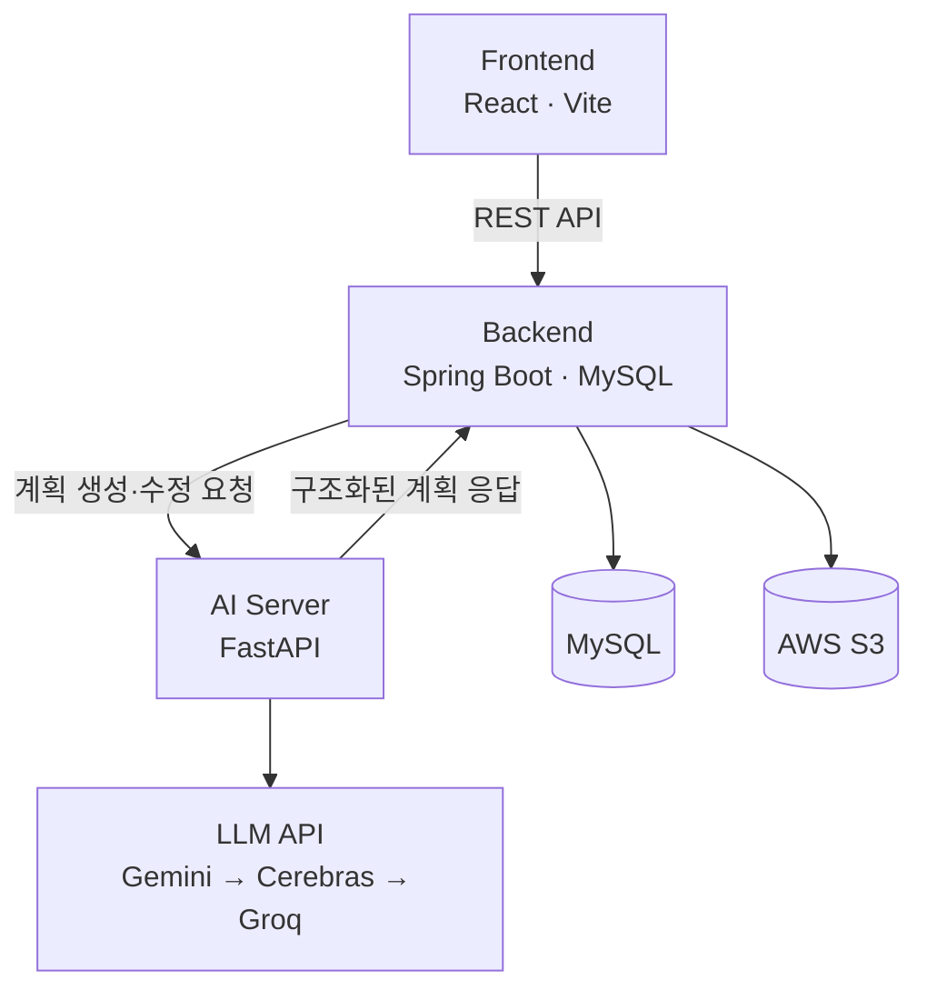

# JustDO | 목표를 계획에서 실행으로

> **막연한 목표를 실천 가능한 일별 계획으로 바꾸고, 매일의 성취를 퍼즐로 보여주는 AI 목표 실행 서비스**

**카카오테크 부트캠프 13조 해커톤** · 2026.08.19–08.20 개발, 08.21 발표 · 6인 팀(AI 2 / 풀스택 2 / 클라우드 2)

사용자가 목표를 한 문장으로 입력하면 AI가 필요한 정보를 질문하고, 답변을 바탕으로 날짜별 실행 계획을 생성합니다. 사용자는 대화로 계획을 수정·확정하고, 일일 작업을 완료하며 퍼즐 조각으로 진행 상황을 확인합니다.

## 데모

[시연 영상](./13조_동영상.mp4) · [서비스 기획보고서](./JustDO_서비스기획보고서_읽기쉬운버전.pdf)

> **영상 업로드 필요:** 현재 공개 저장소의 `main` 브랜치에는 `13조_동영상.mp4`가 없습니다. 업로드 후 위 링크가 작동합니다. GitHub Issue/Release 첨부 영상 URL로 교체해도 됩니다.

## 핵심 기능

| 기능 | 사용자 경험 |
|---|---|
| **AI 맞춤 질문** | 목표의 종류와 현재 수준, 시작·종료일, 투자 가능 시간 등 계획에 필요한 조건을 수집합니다. |
| **일별 계획 생성** | 목표를 날짜가 지정된 구체적인 작업으로 나눠 계획 초안을 만듭니다. |
| **대화형 계획 수정** | 사용자의 피드백을 반영해 계획을 조정하고, 사용자가 확인한 뒤 확정합니다. |
| **퍼즐·랭킹** | 완료한 작업을 퍼즐 조각으로 시각화하고 성취 기록을 랭킹으로 보여줍니다. |

### 이용 흐름


**예시:** "10km 마라톤 완주" → 기간·현재 운동 수준·가능한 요일 입력 → 날짜별 달리기 계획 생성 → 대화로 일정 조정 → 실행 기록과 퍼즐 확인

## 왜 만들었나요?

목표를 세우는 것보다 **목표를 실행 가능한 작업으로 나누고 꾸준히 이어가는 과정**이 어렵다는 문제에서 출발했습니다.

2026년 8월 진행한 성인 61명 대상 설문(편의표본)에서 **75.4%가 계획 단계에서 중단한 경험**, **82.0%가 목표 완료 전에 중단한 경험**을 보고했습니다. 계획을 끝내지 못한 이유로는 '무엇을 해야 할지 쪼개는 방법을 모름'(48.9%), 목표 완료 전 중단 이유로는 '밀린 일정을 따라잡기 어려움'(45.9%)이 가장 많이 응답됐습니다.

JustDO는 계획 수립의 부담을 AI로 낮추고, 작은 실행의 누적을 퍼즐로 보여주도록 설계했습니다.

*이 설문은 편의표본 61명의 응답이며, 서비스가 실제 목표 달성률을 개선한다는 효과를 검증한 결과는 아닙니다.*

## 시스템 아키텍처



| 구성 요소 | 주요 역할 | 기술 |
|---|---|---|
| [`frontend/`](./frontend) | 목표 입력, 대화 UI, 일정·퍼즐·랭킹 화면 | React 19, Vite, Tailwind CSS |
| [`backend/`](./backend) | 인증, 대화·일정·퍼즐·랭킹 상태 관리, AI 호출 | Spring Boot, JPA, MySQL, AWS S3 |
| [`ai/`](./ai) | 목표별 질문 생성, 일별 계획 생성·수정 | Python, FastAPI, Pydantic, Gemini/Cerebras/Groq |

### AI 처리 구조

AI 서버는 **DB와 세션을 직접 관리하지 않는 무상태 추론 서버**입니다. 백엔드가 목표 정보, 템플릿 답변, 기존 계획, 수정 피드백 등 필요한 맥락을 요청마다 전달하고, AI 서버는 구조화된 계획과 응답을 반환합니다. 대화 기록과 확정 계획의 저장은 백엔드가 담당합니다.

- **질문 생성:** 목표를 분석해 최대 8개 맞춤 질문을 구성하며, 시작일·종료일 질문이 빠지면 코드에서 보완합니다.
- **계획 생성:** 입력 날짜의 유효성을 LLM 호출 전에 검증하고, 최대 30일 범위에서 일별 계획을 생성합니다.
- **계획 수정:** 기존 계획과 사용자 피드백을 받아 수정안을 생성합니다. 수정 결과가 30일을 초과하면 기존 계획을 유지하고 재조정을 안내합니다.
- **구조화 출력 및 폴백:** JSON Schema 기반 응답을 사용하고, Gemini 실패 시 Cerebras, 이후 Groq 순으로 재시도합니다. 실제 사용 가능한 모델은 환경 변수 설정에 따라 달라집니다.

**주요 API:** `POST /plan/generate` · `POST /plan/revise` · `POST /plan/confirm` (호환용 엔드포인트이며 현재 백엔드 확정 저장 흐름에서는 별도 호출이 필요하지 않음)

## 실행 방법

전체 서비스는 프론트엔드·백엔드·AI 서버로 구성되어 있습니다. 아래는 **AI 서버 단독 실행** 예시입니다. 전체 서비스 실행과 인프라 설정은 각 디렉터리의 설정 파일을 확인해 주세요.

```bash
cd ai
python3 -m venv .venv
source .venv/bin/activate
pip install -r requirements.txt
cp .env.example .env
# .env에 사용할 LLM API 키 설정
uvicorn app.main:app --reload
```

API 문서: `http://localhost:8000/docs`

```bash
# ai/ 디렉터리에서 실행
pytest           # LLM 호출을 모킹한 단위 테스트
pytest -m live   # 실제 프로바이더 호출 (API 키 필요)
```

> 질문 생성 기능은 `GEMINI_API_KEY`가 필요합니다. 계획 생성·수정은 설정된 키에 따라 Gemini → Cerebras → Groq 순서로 시도합니다. AI 서버 단독 실행만으로 프론트엔드의 전체 사용자 흐름이 작동하는 것은 아닙니다.

## 구현 범위와 다음 단계

**해커톤 구현:** 맞춤 질문 생성, 계획 초안 생성·대화 수정, 백엔드 일정 저장 연계, 퍼즐·랭킹을 포함한 서비스 구조.

**후속 개발 우선순위:** 미완료 작업을 남은 기간에 재배치하는 **자동 리스케줄링**. 기존 README와 기획보고서에서 다음 단계로 제시한 기능으로, 현재 완료 기능으로 소개하지 않습니다.

출시 이후 검증할 지표는 계획 확정률, 첫 작업 실행률, 7일 유지율, 리스케줄 회복률, 목표 완료율입니다. 아직 실측 성과 지표로 제시하지 않습니다.

## 프로젝트 문서

- [서비스 기획보고서 — 읽기 쉬운 버전](./JustDO_서비스기획보고서_읽기쉬운버전.pdf)
- [서비스 기획보고서 — 원본](./서비스기획보고서%20%281%29.pdf)
- [AI 서버 설명 및 API](./ai/README.md)
- [백엔드 API 명세](./backend/docs/API_SPECIFICATION_NOTION_최종.md)
- [백엔드 ERD](./backend/docs/ERD_SPECIFICATION_최종.md)
- [프론트엔드](./frontend/)

---

**JustDO** · KTB4 AI Hackathon Team 13
